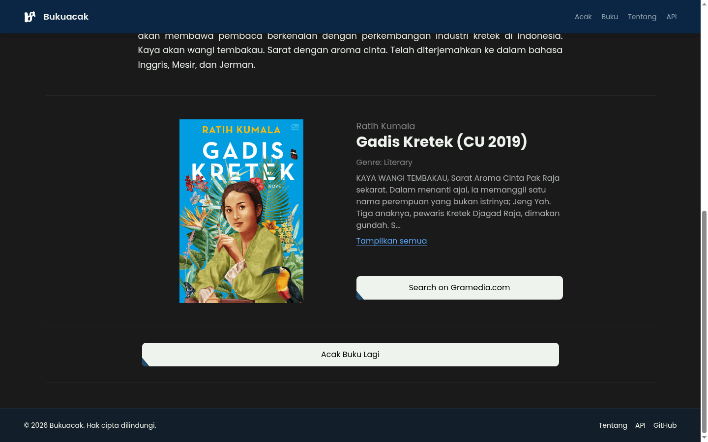
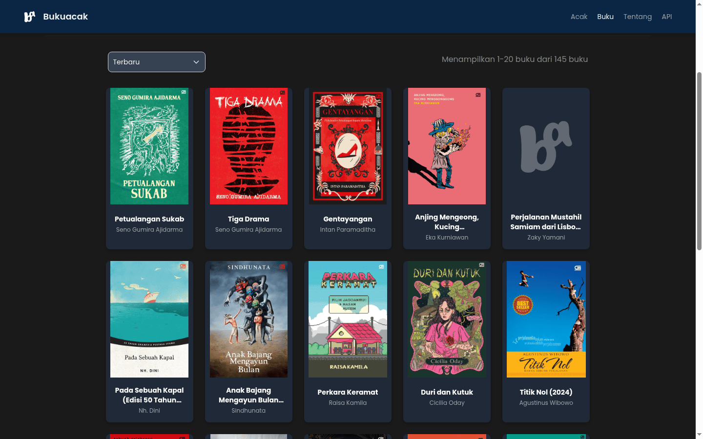
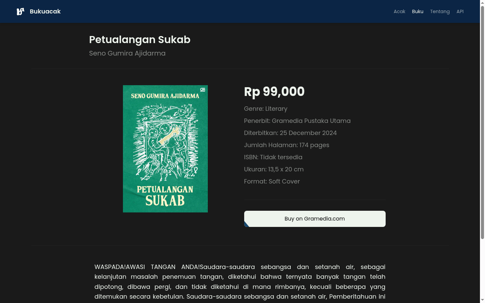
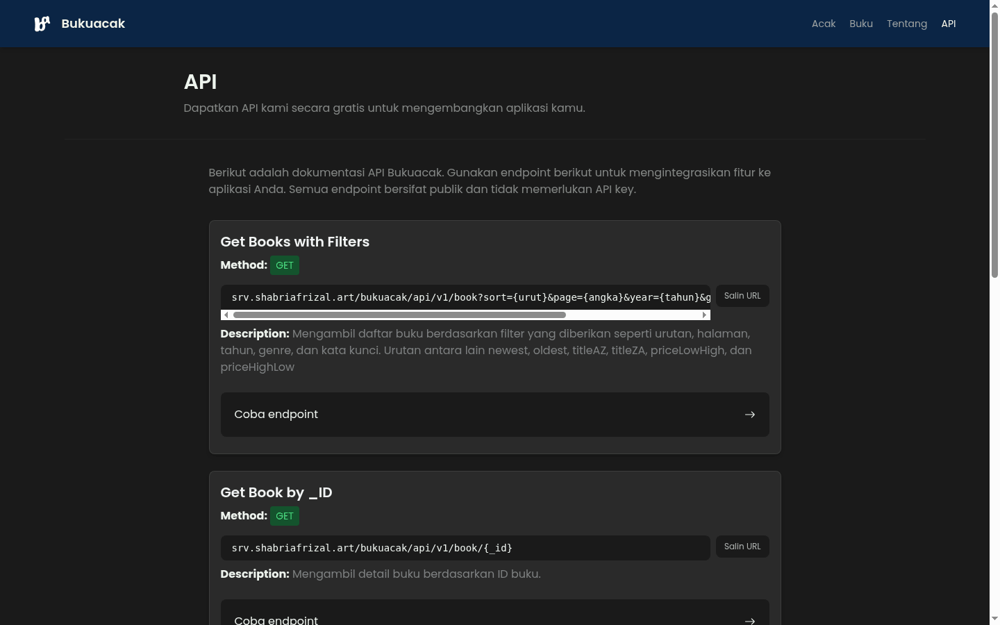
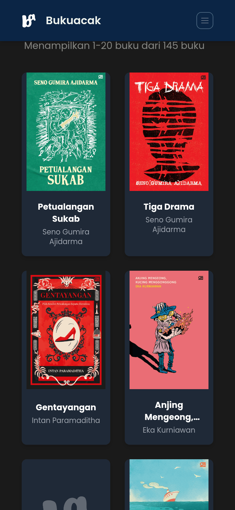

<p align="center">
  <picture>
    <source media="(prefers-color-scheme: dark)" srcset="public/bukuacak_w.png">
    
  </picture>
</p>

<h1 align="center">Bukuacak</h1>

<p align="center"><strong>Find your next book by chance.</strong><br>
A random book picker and a browsable collection of 2,700+ Indonesian titles —
filter by genre, year and keyword, sort by price or title, and read the details
before you buy.</p>

<p align="center">
  <a href="LICENSE"></a>
  
  
  
</p>

<p align="center">
  <a href="https://bukuacak.shabsolute.tech"></a>
  <a href="https://bukuacak.shabsolute.tech/api"></a>
  <a href="https://github.com/shabriafrizal/bukuacak-api"></a>
</p>

<p align="center">
  <a href="https://bukuacak.shabsolute.tech">Open the app</a> ·
  <a href="#quick-start">Quick start</a> ·
  <a href="#usage">Usage</a> ·
  <a href="#screenshots">Screenshots</a> ·
  <a href="#how-it-works">How it works</a> ·
  <a href="#development">Development</a>
</p>

<p align="center">
  
</p>

## About

Bukuacak (*buku acak* — a random book, in Indonesian) answers one question: what
should I read next? Press one button and it hands you a book from the catalogue,
with its cover, author, genre, summary and a link to buy it. If you would rather
browse, the collection page filters 2,700+ titles by genre, year and keyword,
sorts them by newest, oldest, title or price, and paginates the result.

The front end is a static React app. All book data comes from the
[Bukuacak API](https://github.com/shabriafrizal/bukuacak-api), which is also
public and documented in the app at `/api`.

**What makes it different**

- **One button, no forms.** The random pick respects your genre, year and keyword filters.
- **Shareable state.** Every filter lives in the URL, so a search can be bookmarked or sent to someone.
- **Honest about failure.** A dead API or a missing cover shows an error or a fallback, never a silent empty page.
- **Free API.** Every endpoint the app uses is documented and open for your own projects.

> [!NOTE]
> Book metadata and covers are collected from public Gramedia listings. Some
> cover images have been removed at the source; the app falls back to the
> Bukuacak logo instead of a broken image. This project is not affiliated with
> Gramedia.

## Features

| Area | What you get |
| --- | --- |
| **Random pick** | One click returns a book, optionally narrowed by genre, year and keyword; re-roll without touching the filters |
| **Collection** | Grid of covers with title and author, 20 per page, with a live result counter |
| **Filters** | Genre (searchable, with counts), year, keyword (debounced), plus six sort orders |
| **Book detail** | Cover, price, publisher, publication date, page count, ISBN, size, format and a store link |
| **API docs** | Every endpoint listed with a description, a copyable URL and a "try it" link |
| **States** | Loading skeletons, "no results" with a filter reset, and an error alert with retry |
| **Accessibility** | Cards are real links, keyboard-navigable filters and pagination, visible focus rings, reduced-motion support |
| **SEO** | Per-page title, description, canonical, Open Graph and `Book` structured data |
| **Mobile** | Two-column grid, collapsible navigation, touch-friendly controls |

## Quick start

### Run it locally

```bash
git clone https://github.com/shabriafrizal/bukuacak.git
cd bukuacak
npm install
npm run dev
```

Open the printed URL (usually <http://localhost:5173>). The app talks to the
hosted API, so there is nothing else to start.

**Requirements:** Node.js 18 or newer and npm.

### Use the hosted build

**<https://bukuacak.shabsolute.tech>** — deployed on Vercel. The same build is
also served at <https://bukuacak.vercel.app>.

## Usage

### Get a random book

1. Open the app. Optionally set a **genre**, **year** or **keyword**.
2. Press **Acak Buku**.
3. Read the summary and book details; press **Tampilkan Buku** to unblur the card.
4. Press **Acak Buku Lagi** for another draw, or **Hapus filter** to start over.

### Browse the collection

1. Go to **Buku**.
2. Narrow the list with the filters on top; the URL updates as you go, so you can share or reload it.
3. Change the sort order with the dropdown above the grid.
4. Click any cover to open its detail page.

### Read the API docs

**API** lists every endpoint with its parameters, an example URL, and a copy
button. The examples are generated from the same base URL the app uses, so they
always point at the live server.

## Screenshots

| Collection | Book detail |
| --- | --- |
|  |  |

| API documentation | Mobile |
| --- | --- |
|  |  |

## How it works

The app is a thin client over one JSON API. Requests go through
`src/config/api.js`, which owns the base URL and turns every failure into an
error the UI can show:

```js
// src/config/api.js
export const buildApiUrl = (path, query) => { /* ... */ };

export const fetchJson = async (path, { query, signal } = {}) => {
  const response = await fetch(buildApiUrl(path, query), { signal });
  if (!response.ok) throw new ApiError(/* status + message */);
  return JSON.parse(await response.text());
};
```

Three rules keep the UI predictable:

1. **One data layer.** Pages never build URLs by hand, so changing the API host
   is a one-line edit or a `VITE_API_BASE_URL` value.
2. **Every request can be cancelled.** Changing a filter or leaving a page aborts
   the request in flight, so an old response can never overwrite a newer one.
3. **The URL is the state.** The collection page reads its filters from query
   parameters, which makes results shareable and the back button work.

### Endpoints used

Base URL: `https://srv.shabriafrizal.art/bukuacak/api/v1`

| Endpoint | Used by |
| --- | --- |
| `GET /book?sort=&page=&year=&genre=&keyword=` | Collection page |
| `GET /book/{_id}` | Book detail page |
| `GET /random_book?year=&genre=&keyword=` | Random pick |
| `GET /stats/genre` | Genre filter (names and counts) |

`sort` accepts `newest`, `oldest`, `titleAZ`, `titleZA`, `priceLowHigh` and
`priceHighLow`. A book looks like this:

```json
{
  "title": "Gadis Kretek",
  "cover_image": "https://…/gadis-kretek.jpg",
  "author": { "name": "Ratih Kumala" },
  "category": { "name": "Literary" },
  "summary": "…",
  "details": { "price": "Rp 99,000", "total_pages": "384 pages", "isbn": "…" },
  "buy_links": [{ "store": "Search on Gramedia.com", "url": "https://…" }]
}
```

> [!NOTE]
> When nothing matches the filters, the API answers `404`. Some of its error
> responses omit CORS headers, so the browser reports them as a network error;
> the app treats both cases as "no book matched".

## Tech stack

| Layer | Choice |
| --- | --- |
| UI | React 18 |
| Routing | React Router 7 |
| Build | Vite 6 |
| Styling | Tailwind CSS 3 + self-hosted Poppins |
| Icons | Inline SVG |
| Data | [Bukuacak API](https://github.com/shabriafrizal/bukuacak-api) over `fetch` |
| Hosting | Vercel (static build + rewrites) |
| SEO | `src/Seo.jsx` — title, description, canonical, Open Graph, JSON-LD |

## Project structure

```text
src/
  config/
    api.js             base URL, buildApiUrl, fetchJson, ApiError
    seo.js             site URL, name, default description and image
  routes/
    Acak.jsx           random pick (home)
    Buku.jsx           collection: filters, sort, pagination, error states
    Detail.jsx         single book + Book structured data
    API.jsx            API documentation page
    Tentang.jsx        about page
    NotFound.jsx       404 page
  components (flat in src/, shared by the routes)
    BookGrid.jsx       cover card with fallback image and lazy loading
    BookDetail.jsx     detail layout
    BookAcakDetail.jsx returned book card with reveal overlay
    GenreDropdown.jsx  searchable genre list with counts
    YearDropdown.jsx   year filter
    SortDropdown.jsx   sort order
    Pagination.jsx     page numbers with aria-current
    TextAnimator.jsx   word-by-word summary reveal
    Navbar.jsx         responsive navigation
    Seo.jsx            per-page document head
```

## Development

```bash
npm run dev       # dev server with hot reload
npm run build     # production build into dist/
npm run preview   # serve the production build on :4173
npm run lint      # ESLint (flat config)
```

### Configuration

The defaults work out of the box. Copy `.env.example` to `.env` to override them.

| Variable | Default | Purpose |
| --- | --- | --- |
| `VITE_API_BASE_URL` | `https://srv.shabriafrizal.art/bukuacak/api/v1` | API host |
| `VITE_SITE_URL` | `https://bukuacak.shabsolute.tech` | Origin for canonical and Open Graph URLs |

### Deploy

Any static host works; this repository is deployed on Vercel.

| Setting | Value |
| --- | --- |
| Build command | `npm run build` |
| Output directory | `dist` |
| Rewrites | `vercel.json` sends every path to `index.html` so client routes survive a reload |

Set the two variables above in the project environment if the API host or domain
changes.

## Contributing

Issues and pull requests are welcome — especially accessibility fixes, filter
improvements and broken-cover reports. Please run `npm run lint && npm run build`
before opening a pull request.
